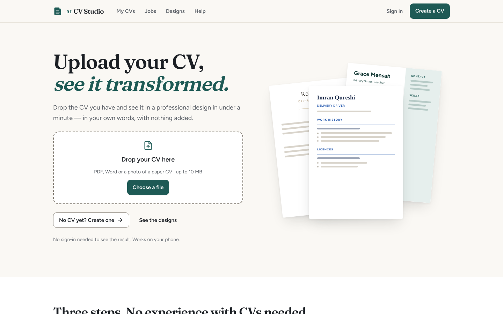
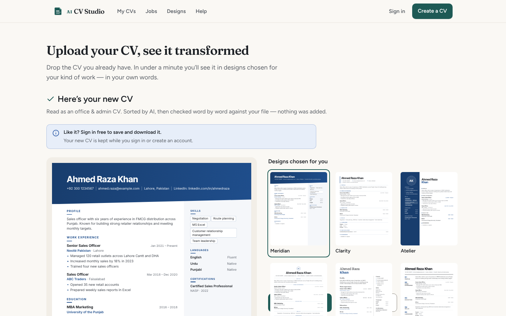
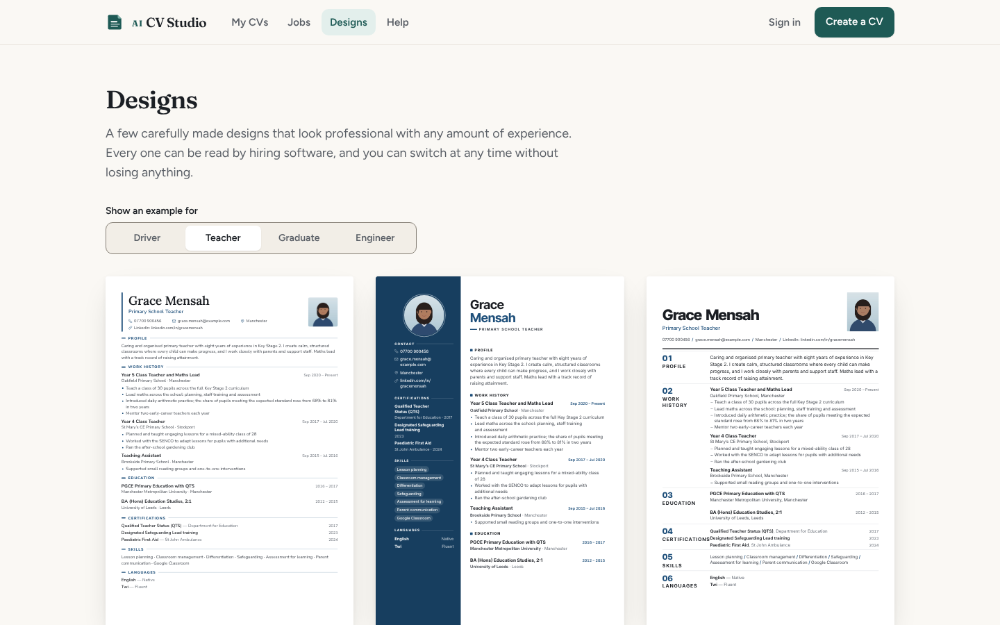
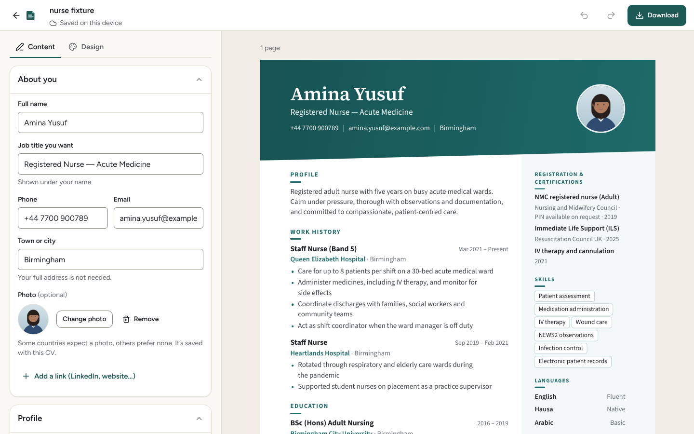
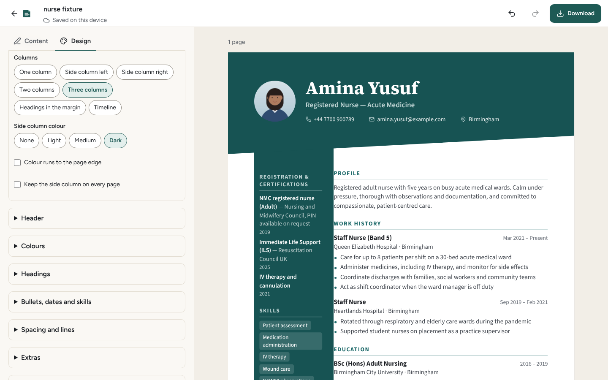
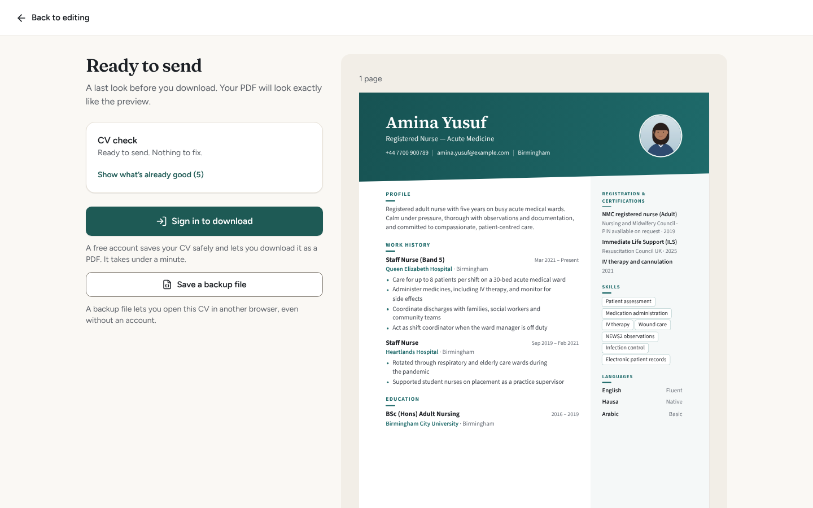
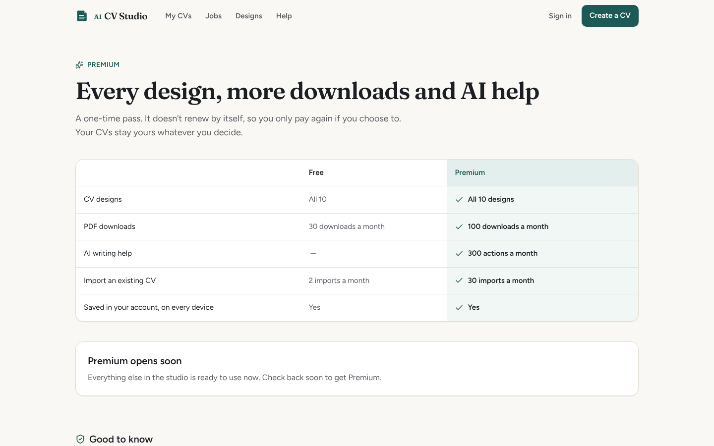
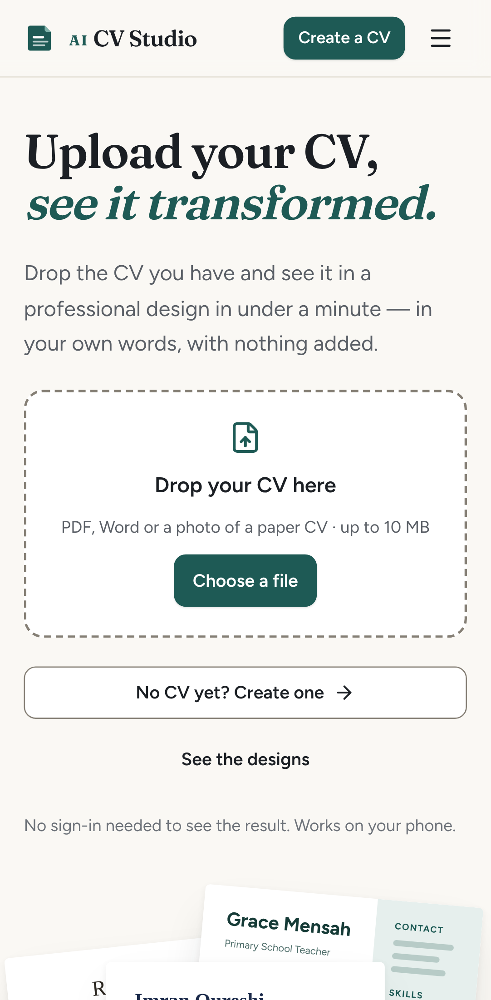
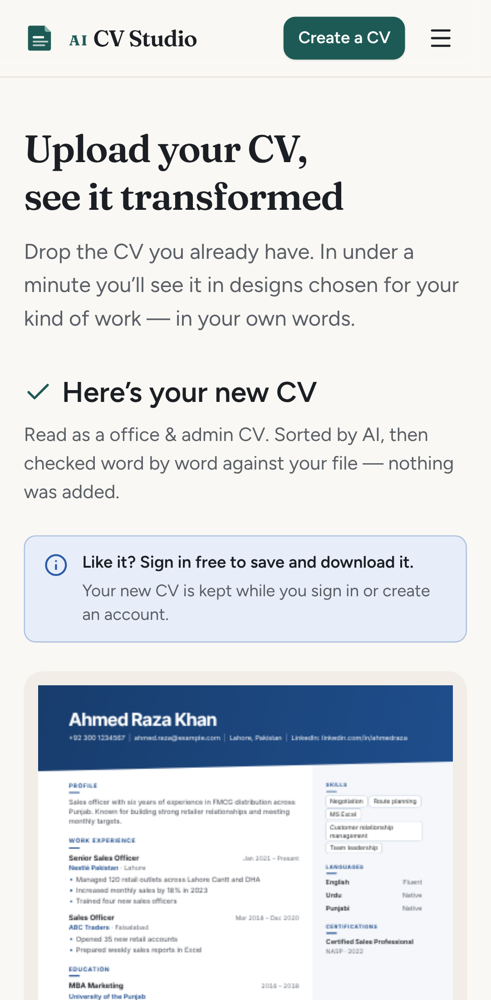

# Screenshots

Taken from a local production build (`npm run build`, in-memory store, demo AI) on 2026-11-13,
at 1440 × 900 (desktop) and Pixel 7 (mobile). Sample people are fictional.

| | |
|---|---|
|  **Home** — upload your CV, see it transformed (R5) |  **Instant Makeover** — your own CV in designs ranked for your work (R5) |
|  **Designs** — the 10 catalogue designs with sample CVs |  **Editor** — fields on the left, the exact PDF preview on the right |
|  **Design Studio** — three columns, dark side column (R6) |  **Download** — CV check, then PDF or Word |
|  **Premium** — passes, payment methods, order number |  **Phone** — home page |
|  **Phone** — makeover result | |
